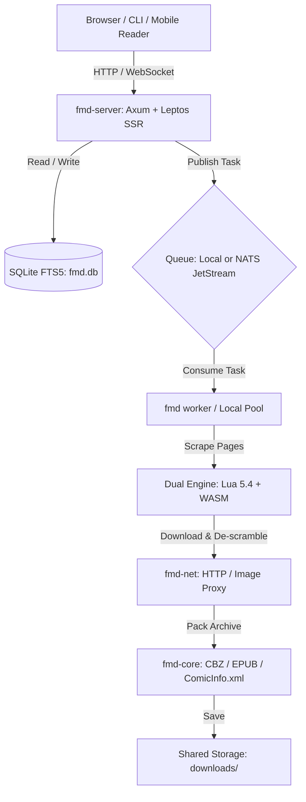

# FMD3 San — Documentation Portal

Welcome to the official documentation for **Free Manga Downloader 3 — San (FMD3 / FMD三) — Rust Edition**.

FMD3 is a modern, high-performance headless daemon, CLI suite, and Web UI application written in safe Rust. It offers complete compatibility with legacy FMD2 Lua modules while introducing WebAssembly sandboxing, distributed NATS JetStream processing, and cloud-native Kubernetes deployment.

---

## 📚 Documentation Sections

### 1. [Technical Documentation](technical/architecture.md)
For software engineers, system architects, and DevOps contributors:
- **[Architecture Overview](technical/architecture.md)**: Deep dive into the 7 workspace crates, concurrency model, and data pipelines.
- **[REST API & WebSocket Reference](technical/api-reference.md)**: Comprehensive reference for all HTTP endpoints and real-time streaming WebSocket events.
- **[Scraping Engines (Lua & WASM)](technical/scraping-engines.md)**: Detailed specification of Lua 5.4 emulation, C Protobuf bindings, and Wasmtime ABI guest contracts.
- **[Distributed Queue & Workers](technical/distributed-queue.md)**: Scalable worker architecture powered by NATS JetStream.
- **[Database Schema & FTS5](technical/database-schema.md)**: SQLite relational models, full-text search indexing, and migration guarantees.

### 2. [User Guides](user/getting-started.md)
For homelab owners, administrators, and end users:
- **[Getting Started](user/getting-started.md)**: Deployment using Docker Compose, Helm (Kubernetes), Cargo, or Nix Flake.
- **[Web UI Guide](user/web-ui-guide.md)**: Walkthrough of the Leptos SSR interface, library tracking, chapter inspector, and multi-source merging.
- **[CLI Command Reference](user/cli-reference.md)**: Manual for headless operations, batch verification, and background worker commands.
- **[Configuration & Metadata](user/configuration.md)**: Archive compression (CBZ, EPUB, PDF), `ComicInfo.xml` formatting for Komga/Kavita, and FlareSolverr setup.

### 3. [AI & LLM Integration](llm/module-development-llm.md)
For Large Language Models, autonomous coding agents, and agentic workflows:
- **[llms.txt (Root Discovery)](../llms.txt)**: Fast index following the standard open LLM directory specification.
- **[llms-full.txt (Consolidated Context)](../llms-full.txt)**: Single comprehensive context file designed for direct injection into LLM prompts.
- **[LLM Module Development Guide](llm/module-development-llm.md)**: Formal prompt rules and code templates for generating bug-free Lua and WASM scraper modules.
- **[Agent Integration Guide](llm/agent-integration.md)**: Strict JSON schemas and task workflows for autonomous agent orchestrations.

---

## ⚡ Quick Architecture Overview

