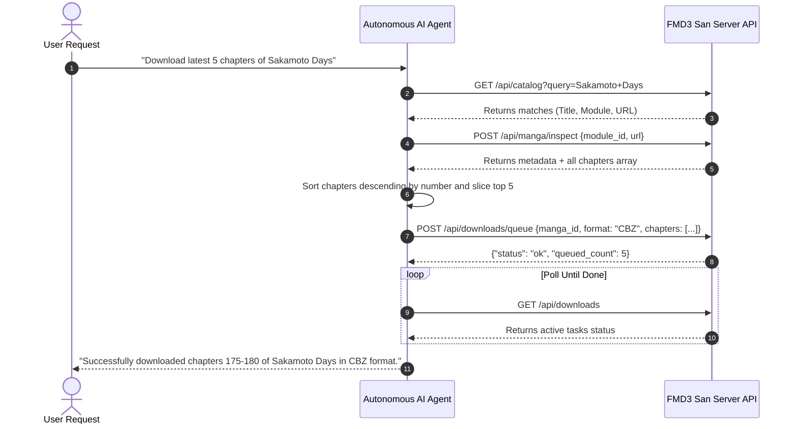

# Autonomous Agent Integration Guide for FMD3

This document defines machine-readable contracts and interaction flows for **autonomous AI agents** (e.g. OpenAI Function Calling, Claude Tool Use, ReAct planners) integrating with the FMD2 server.

---

## 1. Standard Agent Tool Definitions (JSON Schema)

When configuring an AI agent to control FMD3, supply the following function/tool schemas:

### 1.1 `fmd_search_catalog`
Searches the local SQLite FTS5 index for manga titles across synchronized modules.

```json
{
  "name": "fmd_search_catalog",
  "description": "Search the local FTS5 manga catalog by title keyword.",
  "parameters": {
    "type": "object",
    "properties": {
      "query": { "type": "string", "description": "Title or partial keyword (e.g. 'One Piece', 'Jujutsu')" },
      "module_id": { "type": "string", "description": "Optional module filter (or 'all')" }
    },
    "required": ["query"]
  }
}
```

### 1.2 `fmd_inspect_manga`
Scrapes the live web page of a series to obtain updated metadata and the full chapter checklist.

```json
{
  "name": "fmd_inspect_manga",
  "description": "Inspect a manga page to extract metadata, cover, summary, and all chapter links.",
  "parameters": {
    "type": "object",
    "properties": {
      "module_id": { "type": "string", "description": "ID of the target scraper module" },
      "url": { "type": "string", "description": "Full HTTP(S) URL of the manga page" }
    },
    "required": ["module_id", "url"]
  }
}
```

### 1.3 `fmd_queue_download`
Queues a list of selected chapters for background downloading and archive packaging.

```json
{
  "name": "fmd_queue_download",
  "description": "Queue one or more chapters for downloading and packaging.",
  "parameters": {
    "type": "object",
    "properties": {
      "manga_id": { "type": "string", "description": "Canonical manga identifier from inspection" },
      "format": { 
        "type": "string", 
        "enum": ["CBZ", "PDF", "EPUB", "Directory"],
        "default": "CBZ"
      },
      "chapters": {
        "type": "array",
        "items": {
          "type": "object",
          "properties": {
            "url": { "type": "string" },
            "title": { "type": "string" },
            "number": { "type": "number" },
            "module_id": { "type": "string" }
          },
          "required": ["url", "title", "module_id"]
        }
      }
    },
    "required": ["manga_id", "chapters"]
  }
}
```

### 1.4 `fmd_get_downloads_status`
Queries active, pending, completed, or failed download tasks.

```json
{
  "name": "fmd_get_downloads_status",
  "description": "Poll the state of download tasks in the FMD2 processing queue.",
  "parameters": {
    "type": "object",
    "properties": {}
  }
}
```

---

## 2. Standard Autonomous Workflow Execution

When an AI agent is instructed to *"Download the latest 5 chapters of Sakamoto Days in CBZ format"*, the agent should execute the following sequence:


