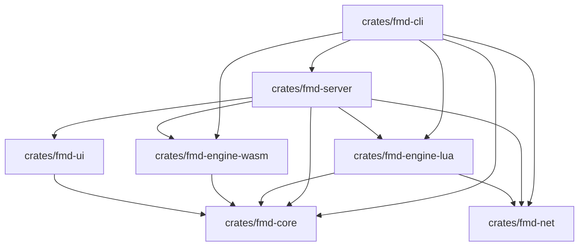
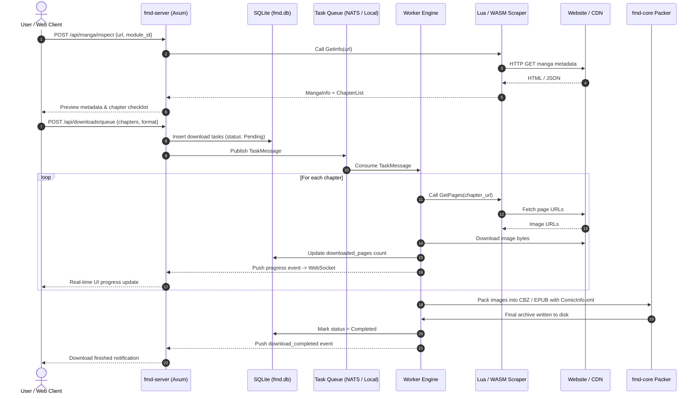

# FMD3 San — Technical Architecture

This document describes the internal software architecture of **Free Manga Downloader 3 — San (FMD3 / FMD三) — Rust Edition**.

---

## 1. Workspace Crate Layout

The project is structured as a modular Cargo workspace composed of 7 specialized crates:

```text
crates/
├── fmd-core/            # Domain models, SQLite persistence, ComicInfo.xml packer, queue contracts
├── fmd-engine-lua/      # Lua 5.4 VM, Pascal FMD2 runtime emulation, C Protobuf bindings
├── fmd-engine-wasm/     # Wasmtime 29 sandbox, ABI guest contracts, fuel metering
├── fmd-net/             # HTTP client, image proxy, Cloudflare bypass hooks, WireMock tests
├── fmd-server/          # Axum REST API, WebSocket pub/sub streamer, embedded Web UI
├── fmd-ui/              # Leptos 0.7 SSR frontend components and client runtime
└── fmd-cli/             # Unified binary executable and distributed worker CLI
```

### Dependency Graph



---

## 2. Crates Deep Dive

### `fmd-core`
- **Responsibility**: Foundation crate containing all database models, SQLite migrations, task serialization contracts, puzzle descramblers, and file packagers.
- **Key Modules**:
  - `db.rs`: SQLite connection pool using SQLx with automatic WAL (Write-Ahead Logging), schema migrations, and full-text search indexing (`catalog_fts`).
  - `packer.rs`: Zip archive and EPUB packager injecting standardized `ComicInfo.xml` metadata for e-reader compatibility (Komga, Kavita, Mihon).
  - `puzzle.rs`: Puzzle tile descrambler algorithms (e.g. Bilibili Comics image un-shuffling).
  - `queue.rs`: Serialized task contracts (`TaskMessage`, `TaskKind`, `TaskProgressUpdate`, `TaskCompleteUpdate`) for in-memory and NATS JetStream execution.
  - `merger.rs`: Multi-source chapter alignment and gap-filling logic.

### `fmd-engine-lua`
- **Responsibility**: Backward-compatible execution of all 429+ legacy FMD2 scraper modules written in Lua.
- **Pascal Emulation Layer**:
  - `TXQuery`: Tree-based HTML/XML parser providing full XPath query capabilities. Crucially supports relative XPath execution with context nodes: `x.XPathString('...', context_node)`.
  - `LuaStringList`: Emulation of Lazarus `TStringList` with 0-indexed and 1-indexed access, sorting, and splitting.
  - `Duktape`: Embedded JavaScript execution for modules that decrypt JSON payloads with inline JS.
  - `pb.c`: Native C Protobuf binding compiled via `build.rs` for binary protobuf parsing (used by MangaPlus).

### `fmd-engine-wasm`
- **Responsibility**: Next-generation sandboxed module execution and image transformation filters.
- **Key Features**:
  - Sandboxed execution using `wasmtime` 29 WebAssembly runtime.
  - **Fuel Metering**: Explicit fuel limits prevent infinite loops or denial-of-service in third-party scrapers.
  - **Memory Isolation**: Guest modules run inside dedicated linear memories. Host pointers are translated with boundary checks.
  - **C-ABI Contract**: Typed functions `fmd_module_info`, `fmd_get_manga`, `fmd_get_pages`, and `fmd_apply_filter`.

### `fmd-net`
- **Responsibility**: Resilient network communication, retry policies, and anti-hotlink protections.
- **Key Features**:
  - Reqwest-based async HTTP client with automated connection reuse.
  - Image reverse-proxy endpoint (`/api/proxy/image`) which automatically attaches correct `Referer` and `User-Agent` headers to fetch Cloudflare-protected covers.
  - Hermetic integration test harness using `wiremock` (`tests/hermetic_integration_test.rs`).

### `fmd-server`
- **Responsibility**: High-performance HTTP and WebSocket daemon.
- **Framework**: Axum with Tokio async tasks.
- **Key Features**:
  - Complete REST API for library, catalog, inspection, downloads, and settings.
  - Bi-directional WebSocket stream (`/api/ws`) pushing real-time progress events to connected web clients.
  - Dual queue support: In-memory MPSC queue for standalone setups, or NATS JetStream publisher for distributed clusters.

### `fmd-ui`
- **Responsibility**: Modern single-page web interface rendered via Leptos 0.7 SSR (`tachys`).
- **Zero-Monolith**: Replaced legacy 1,950-line raw HTML strings with modular, typed Rust view components:
  - `Navbar`: Tab navigation, live WebSocket connection pill, download counters.
  - `LibraryView`: Watched series grid, chapter counters, auto-download toggles.
  - `CatalogView`: Instant FTS5 search across all indexed modules, background sync banner.
  - `SearchView`: Direct URL inspection and interactive chapter checklist.
  - `MergerView`: Dual-source comparison matrix and gap-filling tool.
  - `DownloadsView`: Active downloads table with live page progress and retry controls.
  - `ModulesView`: Full catalog of 429+ website scraper modules with real-time filtering.
  - `SettingsView`: Storage directories, naming templates, FlareSolverr URL, sync intervals.

### `fmd-cli`
- **Responsibility**: Unified CLI command runner and standalone distributed worker daemon.
- **Subcommands**: `serve`, `modules`, `favorites`, `catalog`, `config`, `import-legacy`, `worker`.

---

## 3. Data Processing Pipeline



---

## 4. Security & Isolation Model

1. **WASM Sandboxing**: Guest modules cannot access the host filesystem, environment variables, or arbitrary sockets. They can only communicate via explicit host imports.
2. **Path Sanitization**: All file system operations sanitize manga titles and chapter names using regex sanitizers, preventing path traversal attacks (e.g. `../../etc/passwd`).
3. **Database Integrity**: SQLite is configured with foreign key constraints, explicit transaction rollbacks on failure, and WAL mode for high concurrent read throughput during active downloads.
