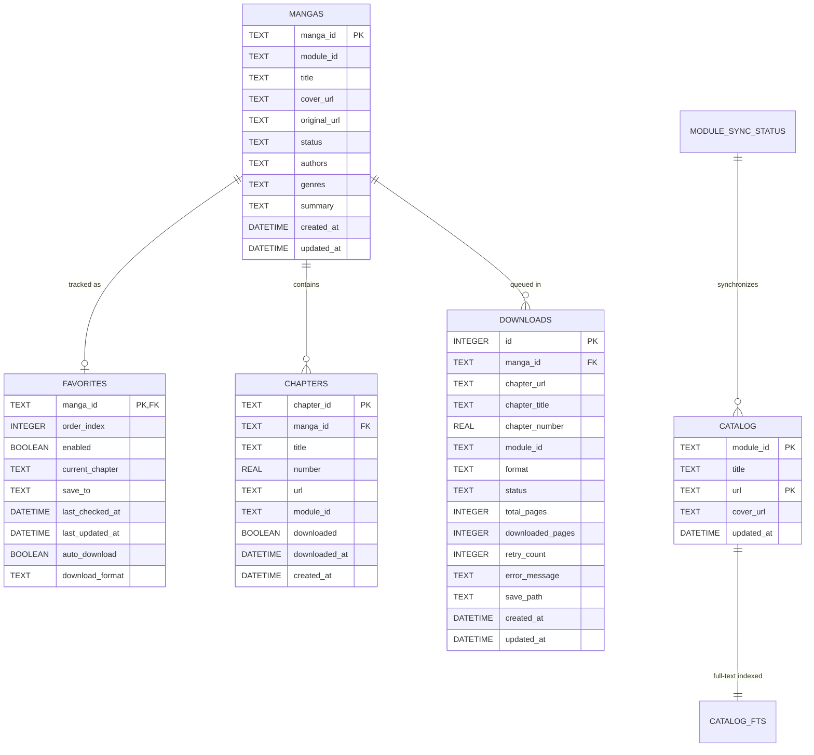

# FMD3 San — Database Schema & SQLite Persistence Specification

FMD3 stores all local state, library tracking, download queues, and catalog indexes in a high-performance SQLite database (`data/fmd.db`).

---

## 1. Engine Configuration & Pragmas

On startup, FMD2 initializes the SQLite connection pool with the following performance pragmas:

```sql
PRAGMA journal_mode = WAL;          -- Write-Ahead Logging allows concurrent readers during writes
PRAGMA synchronous = NORMAL;        -- Optimal durability / performance balance for SSD storage
PRAGMA foreign_keys = ON;           -- Enforces referential integrity
PRAGMA busy_timeout = 10000;        -- 10-second retry timeout preventing database locking errors
PRAGMA cache_size = -64000;         -- 64MB memory page cache
```

---

## 2. Entity Relationship Diagram



---

## 3. Table Definitions & Indexes

### 3.1 `mangas`
Stores canonical metadata for all manga series discovered through inspection, catalog search, or downloads.

```sql
CREATE TABLE IF NOT EXISTS mangas (
    manga_id TEXT PRIMARY KEY,
    module_id TEXT NOT NULL,
    title TEXT NOT NULL,
    cover_url TEXT,
    original_url TEXT NOT NULL,
    status TEXT DEFAULT 'Unknown',
    authors TEXT,
    genres TEXT,
    summary TEXT,
    created_at DATETIME DEFAULT CURRENT_TIMESTAMP,
    updated_at DATETIME DEFAULT CURRENT_TIMESTAMP
);
CREATE INDEX IF NOT EXISTS idx_mangas_module ON mangas(module_id);
CREATE INDEX IF NOT EXISTS idx_mangas_title ON mangas(title);
```

### 3.2 `favorites`
Represents the user's library and watched list.

```sql
CREATE TABLE IF NOT EXISTS favorites (
    manga_id TEXT PRIMARY KEY REFERENCES mangas(manga_id) ON DELETE CASCADE,
    order_index INTEGER DEFAULT 0,
    enabled BOOLEAN DEFAULT 1,
    current_chapter TEXT,
    save_to TEXT,
    last_checked_at DATETIME,
    last_updated_at DATETIME,
    auto_download BOOLEAN DEFAULT 0,
    download_format TEXT DEFAULT 'CBZ'
);
```

### 3.3 `downloads`
Active and historical queue of chapter downloads.

```sql
CREATE TABLE IF NOT EXISTS downloads (
    id INTEGER PRIMARY KEY AUTOINCREMENT,
    manga_id TEXT NOT NULL,
    chapter_url TEXT NOT NULL,
    chapter_title TEXT NOT NULL,
    chapter_number REAL,
    module_id TEXT NOT NULL,
    format TEXT NOT NULL DEFAULT 'CBZ',
    status TEXT NOT NULL DEFAULT 'Pending',
    total_pages INTEGER DEFAULT 0,
    downloaded_pages INTEGER DEFAULT 0,
    retry_count INTEGER DEFAULT 0,
    error_message TEXT,
    save_path TEXT,
    created_at DATETIME DEFAULT CURRENT_TIMESTAMP,
    updated_at DATETIME DEFAULT CURRENT_TIMESTAMP
);
CREATE INDEX IF NOT EXISTS idx_downloads_status ON downloads(status);
```

---

## 4. Full-Text Search Catalog (FTS5)

To enable instantaneous searches across tens of thousands of manga series from 429+ website scrapers without overloading target websites, FMD3 utilizes SQLite's **FTS5** extension:

```sql
-- FTS5 Virtual Table
CREATE VIRTUAL TABLE IF NOT EXISTS catalog_fts USING fts5(
    title,
    module_id UNINDEXED,
    url UNINDEXED,
    tokenize = 'unicode61 remove_diacritics 2'
);
```

### Prefix Query Execution
Searches match complete words as well as partial prefix tokens:

```sql
SELECT title, module_id, url 
FROM catalog_fts 
WHERE catalog_fts MATCH 'Jujutsu*' 
ORDER BY rank 
LIMIT 50;
```
