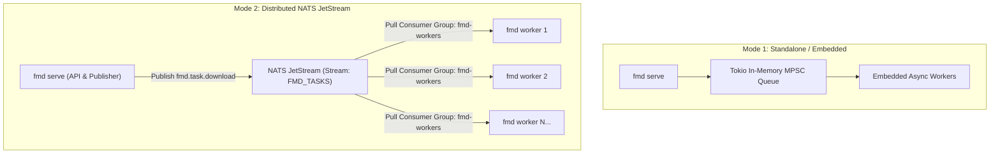
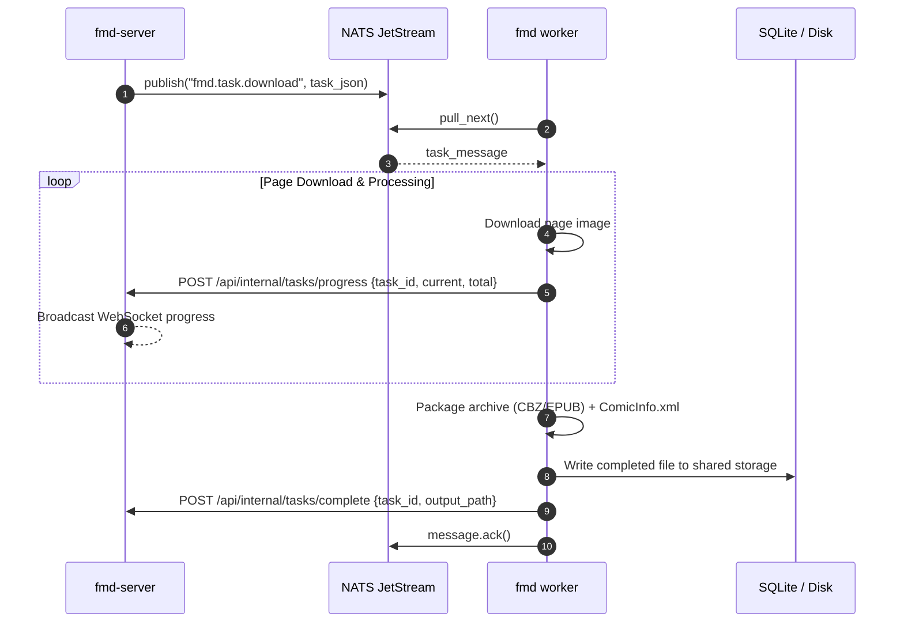

# FMD3 San — Distributed Task Queue Architecture (NATS JetStream)

FMD3 supports both single-binary embedded execution and enterprise-grade distributed scaling across multiple servers and Kubernetes clusters.

---

## 1. Operating Modes



### Automatic Detection
If the environment variable `FMD_NATS_URL` (or the `--nats` CLI flag) is set, FMD3 automatically initializes the NATS JetStream client. If not provided, it falls back seamlessly to the in-memory queue.

---

## 2. NATS JetStream Stream Configuration

When connecting to NATS, FMD3 automatically asserts the stream and durable consumer group:

| Property | Value | Description |
|---|---|---|
| **Stream Name** | `FMD_TASKS` | Primary JetStream stream for download workloads |
| **Subjects** | `fmd.task.download` | Subject for chapter download tasks |
| **Storage** | File / Memory | Configurable persistent or memory-backed stream |
| **Max Age** | 24 Hours | Tasks expire if unconsumed after 24h |
| **Consumer Group** | `fmd-workers` | Competing consumer group for load-balanced worker instances |
| **Ack Policy** | Explicit (`AckPolicy::Explicit`) | Worker must confirm success before task is removed from queue |
| **Ack Wait** | 5 Minutes | Tasks are redelivered if a worker crashes mid-download |

---

## 3. Task Serialization Contract (`TaskMessage`)

Messages published to `fmd.task.download` contain the complete execution context serialized as JSON:

```json
{
  "task_id": 1042,
  "manga_id": "1acdfb072dc744c694a481ef0f4da6c3:https://www.novelcool.com/novel/One-Piece.html",
  "manga_title": "One Piece",
  "chapter_url": "https://www.novelcool.com/chapter/One-Piece-Chapter-1120/12345/",
  "chapter_title": "Chapter 1120",
  "chapter_number": 1120.0,
  "module_id": "1acdfb072dc744c694a481ef0f4da6c3",
  "format": "CBZ",
  "save_dir": "/data/mangas",
  "naming_template": "{manga}/{chapter}.{ext}"
}
```

---

## 4. Worker Execution Lifecycle



### Fault Tolerance & Redelivery
- If a worker encounters a network timeout or fatal panic, it does not send `ack()`.
- After `Ack Wait` (default 5 minutes), NATS JetStream automatically offers the message to another healthy worker.
- If a task consistently fails across maximum retries, the worker reports the failure to `/api/internal/tasks/complete` with an error message and acknowledges the message to prevent infinite retry loops.
