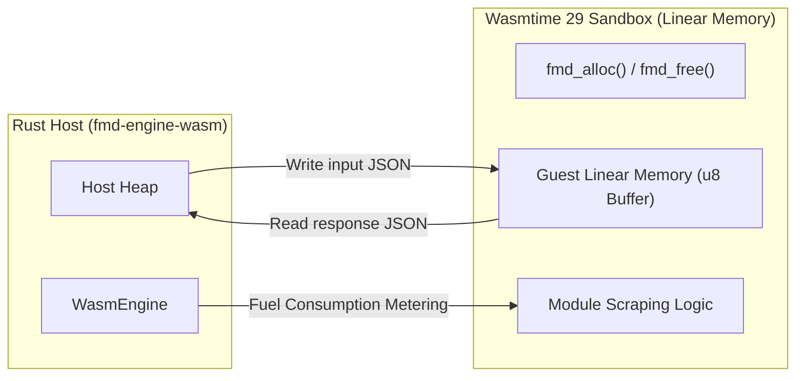

# FMD3 San — Dual Scraping Engine Specification (Lua & WASM)

FMD3 features a state-of-the-art dual scraping engine designed to support hundreds of legacy community scrapers while enabling high-performance, sandboxed WebAssembly execution.

---

## 1. Lua 5.4 Compatibility Engine (`fmd-engine-lua`)

The Lua engine provides 100% backward compatibility with the legacy Pascal/Lazarus FMD2 module ecosystem. Over 429 existing website scrapers run unmodified.

### 1.1 Emulated Pascal/FMD2 Environment

Legacy FMD2 scripts expect specific Lazarus and Pascal objects in their global scope:

| Pascal/Lua Global | Description | Rust Implementation |
|---|---|---|
| `x = TXQuery.Create()` | DOM parser and XPath evaluator | Powered by `kuchiki` / `selectors` with an XPath-to-CSS translation engine |
| `TStringList.Create()` | Dynamic string array and delimiter parser | Rust vector wrapper providing 0-based and 1-based index access |
| `fmd.http` / `HTTP` | Network request provider | Reqwest async client with cookie jar and header injection |
| `fmd.crypto` | Cryptographic primitives (MD5, AES, SHA256) | Pure Rust cryptographic crates (`sha2`, `aes`, `md5`) |
| `pb` | Protocol Buffers binary parser | Native C library (`pb.c`) compiled via `build.rs` and bound via Lua C-API |
| `Duktape` | JavaScript interpreter | Embedded JS engine for decoding packed scripts (e.g. `p,a,c,k,e,d`) |

### 1.2 The Context Node XPath Pattern

A critical pattern in FMD2 Lua modules is evaluating relative XPath expressions on a specific DOM sub-node:

```lua
-- Extract chapter list container
local container = x.XPath('//div[@id="chapters"]//li')
for i = 0, container.Count - 1 do
    local node = container.Get(i)
    -- RELATIVE XPath query evaluated on the node itself:
    local title = x.XPathString('.//a/text()', node)
    local url   = x.XPathString('.//a/@href', node)
    chapters:Add(url .. '|' .. title)
end
```

The Rust engine intercepts `x.XPathString(query, context_node)` and evaluates the query scoped strictly within the subtree of `context_node`, ensuring accurate data extraction without leaking parent document elements.

### 1.3 Sandbox & Execution Limits
To contain untrusted or buggy Lua modules and embedded JavaScript decryptors:
- **Capability Removal**: `load`, `loadfile`, `dofile`, `loadstring`, `io.popen`, `io.tmpfile`, `package.loadlib`, C searchers in `package.searchers`, `pb.loadfile`, and unsafe `os.*` functions (`execute`, `remove`, `rename`, `exit`, `tmpname`, `getenv`, `setlocale`) are stripped.
- **Canonical Filesystem Confinement**: `io.open`, `io.lines`, `io.input`, and `io.output` canonicalize paths (blocking `..` traversal and symlinks escaping allowed roots) and permit read-only access under `lua/` and read/write access strictly under `userdata/`.
- **VM & JS Resource Limits**: Lua is capped at a `64 MiB` memory limit (`set_memory_limit`) with an instruction/wall-clock hook (`50,000,000` instructions / `30s` per callback invocation), while `duktape.ExecJS` (`boa_engine`) enforces `RuntimeLimits` (`1,000,000` loop iterations, `256` recursion depth, `8 KiB` stack).

---

## 2. WebAssembly Engine (`fmd-engine-wasm`)

The WASM engine uses **Wasmtime 29** to run modules compiled from any language targeting `wasm32-unknown-unknown` (Rust, C/C++, TinyGo, AssemblyScript).

### 2.1 Host/Guest Memory Model



1. **Guest Allocation**: The host calls guest's `fmd_alloc(size)` to reserve memory within the guest's linear address space.
2. **Payload Transfer**: Host writes serialized JSON parameters directly into guest memory.
3. **Execution**: Host invokes the target guest export function (e.g. `fmd_get_manga`).
4. **Result Extraction**: Guest returns a 64-bit integer combining `(ptr << 32) | len`. Host safely reads the byte slice from linear memory and deallocates it via `fmd_free`.

### 2.2 Fuel Metering Protection

To prevent rogue modules from blocking async worker threads with infinite loops or heavy operations, every execution consumes fuel:

```rust
// Wasmtime Fuel Configuration
let mut store = Store::new(&engine, ());
store.set_fuel(5_000_000).expect("failed to set fuel");

// Execution automatically halts if fuel runs out:
match instance.get_typed_func::<(i32, i32), i64>(&mut store, "fmd_get_manga") {
    Ok(func) => match func.call(&mut store, (ptr, len)) {
        Ok(result) => { /* Process result */ },
        Err(e) if e.to_string().contains("fuel") => {
            eprintln!("Execution limit exceeded: Out of fuel");
        }
        Err(e) => eprintln!("Execution error: {}", e),
    },
    Err(e) => eprintln!("Export not found: {}", e),
}
```

### 2.3 Guest C-ABI Contract

Any WASM module targeting FMD3 must export the following standard C-ABI symbols:

```rust
// Guest exports required by FMD3
#[no_mangle]
pub extern "C" fn fmd_alloc(size: usize) -> *mut u8;

#[no_mangle]
pub extern "C" fn fmd_free(ptr: *mut u8, size: usize);

#[no_mangle]
pub extern "C" fn fmd_module_info() -> u64;

#[no_mangle]
pub extern "C" fn fmd_get_manga(ptr: *const u8, len: usize) -> u64;

#[no_mangle]
pub extern "C" fn fmd_get_pages(ptr: *const u8, len: usize) -> u64;

#[no_mangle]
pub extern "C" fn fmd_apply_filter(img_ptr: *const u8, img_len: usize, filter_ptr: *const u8, filter_len: usize) -> u64;
```
